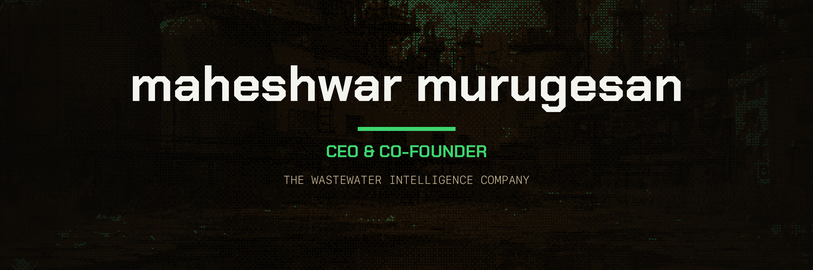
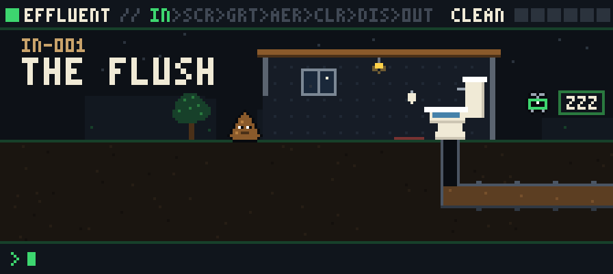

  

 

  

<a href="https://x.com/maheshbiz_">X</a> · <a href="https://instagram.com/mahesh.biz">Instagram</a> · <a href="https://www.linkedin.com/in/maheshwarmurugesan/">LinkedIn</a>

  

<!-- profile-readme nudge -->
